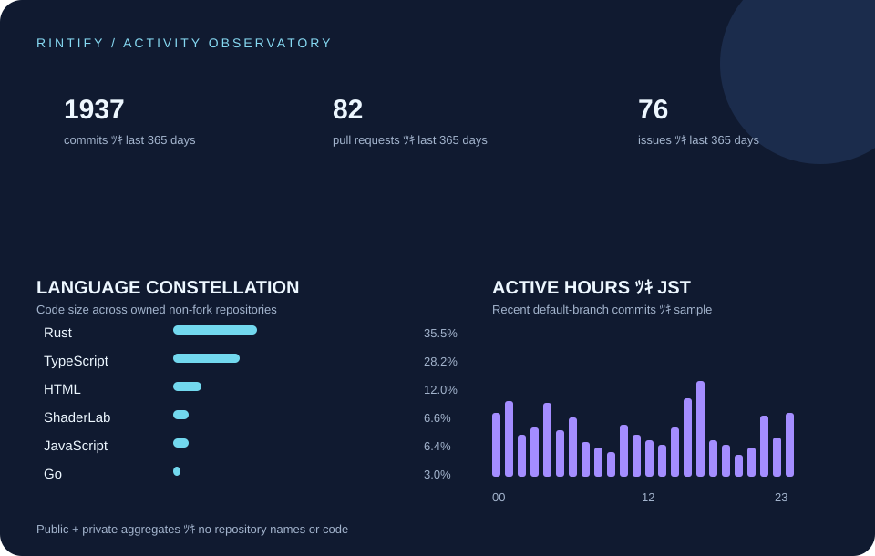

### ✦ りんたま / rintify ✦

**「こんなのあったら楽しそう」を、かたちにする。**

 

### ◇ &nbsp; ACTIVITY OBSERVATORY &nbsp; ◇
公開・非公開の活動を合わせた、ものづくりの軌跡

  

言語の割合は所有リポジトリのコード量から集計。時間帯は各リポジトリの既定ブランチにある直近のコミットをサンプルとして表示しています。

  

**CREATE · EXPLORE · REPEAT**  
つくる → 遊ぶ → ひらめく → またつくる

🌌 &nbsp; 🦭 &nbsp; ✨

