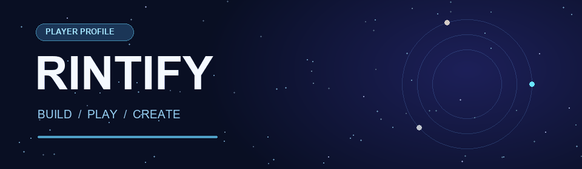

### ✦ りんたま / rintify ✦

**「こんなのあったら楽しそう」を、かたちにする。**

 

### ◇ &nbsp; ACTIVITY ORBIT &nbsp; ◇
日々のものづくりの軌跡

  

 

### ◇ &nbsp; LANGUAGE CONSTELLATION &nbsp; ◇
リポジトリとコミットから見た言語の分布

  

 

  

### ◇ &nbsp; MISSION LOG &nbsp; ◇
活動の記録と時間帯 · 日本時間

  

 

  

**CREATE · EXPLORE · REPEAT**  
つくる → 遊ぶ → ひらめく → またつくる

🌌 &nbsp; 🦭 &nbsp; ✨

